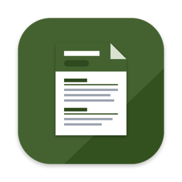
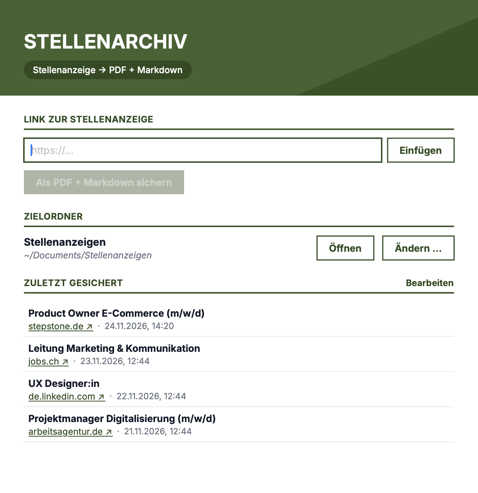

<p align="center">
  
</p>

<h1 align="center">Stellenarchiv</h1>

<p align="center">
  <b>Stellenanzeigen mit einem Klick sichern – als PDF fürs Archiv und als Markdown für Claude &amp; Co.</b><br>
  Kleine, native macOS-App · SwiftUI · keine Abhängigkeiten
</p>

<p align="center">
  
  
  
</p>

---

Stellenanzeigen verschwinden, sobald die Stelle besetzt ist – oft genau dann, wenn man für das Vorstellungsgespräch noch einmal nachlesen will. **Stellenarchiv** sichert eine Anzeige in Sekunden: Link einfügen, Enter drücken, fertig. Heraus kommen ein sauber umbrochenes **A4-PDF** und eine strukturierte **Markdown-Datei**, die du direkt einem KI-Assistenten wie Claude geben kannst, z. B. um ein Anschreiben passgenau auf die Anzeige zuzuschneiden.

<p align="center">
  
</p>

## Funktionen

- **PDF + Markdown in einem Schritt** – mehrseitiges A4-PDF der Originalseite und daneben eine `.md`-Datei mit gleichem Namen.
- **Markdown für KI-Assistenten** – mit YAML-Kopfdaten (Titel, Unternehmen, Ort, Anstellungsart, Veröffentlichungsdatum, Quelle) und dem Anzeigentext mit Überschriften und Aufzählungen. Wo vorhanden, werden die strukturierten [schema.org/JobPosting](https://schema.org/JobPosting)-Daten der Seite genutzt.
- **Cookie-Banner? Erledigt.** – Consent-Dialoge gängiger Anbieter (OneTrust, Usercentrics, Cookiebot, Didomi, Sourcepoint, consentmanager, Borlabs u. v. m.) werden automatisch weggeklickt – bevorzugt mit **„Ablehnen“ / „Nur notwendige“**. Was trotzdem stehen bleibt, wird vor dem Drucken ausgeblendet.
- **„Mehr anzeigen“ wird aufgeklappt** – gekürzte Beschreibungen, Akkordeons und abgeschnittene Textblöcke werden vor dem Export geöffnet.
- **Sinnvolle Dateinamen** – `2026-11-24 – Unternehmen – Stellentitel.pdf`
- **Mehrere Links auf einmal** – einfach eine Liste einfügen, die App arbeitet sie nacheinander ab.
- **Zielordner merken** – einmal wählen, die App merkt sich den Ordner.
- **Verlauf** – zuletzt gesicherte Anzeigen mit anklickbarem Original-Link; einzeln oder gesammelt löschen, auf Wunsch samt Dateien (in den Papierkorb).

Getestet u. a. mit StepStone, LinkedIn (Gastansicht), jobs.ch, karriere.at, stellenanzeigen.de und der Jobbörse der Bundesagentur für Arbeit.

## Beispiel: Markdown-Ausgabe

```markdown
---
titel: "Product Owner E-Commerce (m/w/d)"
unternehmen: "Musterhandel GmbH"
ort: "79098 Freiburg"
anstellung: "FULL_TIME"
veroeffentlicht: "2026-11-20"
quelle: "https://www.example.com/jobs/12345"
abgerufen: 2026-11-24
pdf: "2026-11-24 – Musterhandel GmbH – Product Owner E-Commerce (m w d).pdf"
---

# Product Owner E-Commerce (m/w/d)

- **Unternehmen:** Musterhandel GmbH
- **Ort:** 79098 Freiburg
…

## Stellenanzeige

### Deine Aufgaben

- Verantwortung für das Product Backlog unseres Online-Shops
- …
```

## Installation

Stellenarchiv wird aus dem Quellcode gebaut, du brauchst nur die **Xcode Command Line Tools** (oder Xcode).

```bash
git clone https://github.com/burni2001/Stellenarchiv.git
cd Stellenarchiv
./build.sh install
```

Damit landet `Stellenarchiv.app` in `~/Applications`. Ohne `install` liegt die App nur unter `build/Stellenarchiv.app`.

> Die App ist nur lokal (ad hoc) signiert und nicht notarisiert. Da du sie selbst baust, startet sie normal.

Optional für die Optik: Die Oberfläche nutzt die Schrift [Inter](https://rsms.me/inter/). Ist sie nicht installiert, wird die Systemschrift verwendet.

## Benutzung

1. Link der Stellenanzeige kopieren und in das Feld einfügen (oder auf **Einfügen** klicken).
2. **Enter** drücken bzw. **Als PDF + Markdown sichern** klicken.
3. Beim ersten Mal den Zielordner wählen, danach merkt sich die App den Ordner.

Im Verlauf öffnet ein **Doppelklick** das PDF, ein **Rechtsklick** bietet „Im Finder zeigen“, „Original-Anzeige öffnen“, „Link kopieren“ und „Löschen“. Über **Bearbeiten** lassen sich mehrere Einträge auswählen und auf einmal löschen.

## So funktioniert's

Die Seite wird in einer unsichtbaren `WKWebView` geladen (wie in Safari). Ein Skript läuft in allen Frames, auch in eingebetteten Consent-iframes, und klickt Cookie-Banner weg. Danach werden „Mehr anzeigen“-Bereiche geöffnet und Lazy-Loading-Inhalte durch Scrollen nachgeladen. Während des Exports sind Seitenwechsel gesperrt, damit kein versehentlicher Klick die Anzeige verlässt. Das PDF entsteht über den normalen macOS-Druckweg auf A4. Das Markdown wird aus dem DOM bzw. den JSON-LD-Daten erzeugt.

Alles passiert **lokal auf deinem Mac**. Es gibt keinen Server, kein Tracking und keine Konten.

| Datei | Inhalt |
| --- | --- |
| `Sources/Stellenarchiv/App.swift` | App, Datenmodell, Verlauf, „Über“-Fenster |
| `Sources/Stellenarchiv/ContentView.swift` | Oberfläche |
| `Sources/Stellenarchiv/Exporter.swift` | Laden, PDF-Druck, Markdown-Erzeugung |
| `Sources/Stellenarchiv/PageScripts.swift` | Cookie-Banner-Klicker, „Mehr anzeigen“-Aufklapper |
| `Sources/Stellenarchiv/Theme.swift` | Farben, Typografie, Komponenten |
| `Resources/make-icon.swift` | zeichnet das App-Icon |

## Grenzen

- Seiten, die einen Login verlangen, lassen sich nur so weit sichern, wie sie ohne Anmeldung sichtbar sind.
- Das PDF zeigt die ganze Webseite, also auch Navigation und Seitenleisten, so wie beim Drucken aus Safari.
- Sehr exotische Cookie-Banner werden eventuell nicht geklickt. Sie werden dann aber vor dem Drucken ausgeblendet.

## Für Entwickler:innen

```bash
# Einzelne Anzeige ohne Oberfläche exportieren (gibt Pfade aus)
build/Stellenarchiv.app/Contents/MacOS/Stellenarchiv --export "<url>" ~/Desktop

# Mit Diagnose (welcher Banner-Knopf wurde geklickt, was wurde aufgeklappt)
STELLENARCHIV_DEBUG=1 STELLENARCHIV_FRESH=1 build/Stellenarchiv.app/Contents/MacOS/Stellenarchiv --export "<url>" ~/Desktop

# Demo-Modus mit Beispieldaten (getrennt vom echten Verlauf)
STELLENARCHIV_DEMO=1 build/Stellenarchiv.app/Contents/MacOS/Stellenarchiv
```

`STELLENARCHIV_FRESH=1` nutzt einen leeren Browser-Speicher, damit Cookie-Banner wieder erscheinen.

## Design

Die Oberfläche folgt einer schlichten Bewerbungs-CD: Waldgrün (`#446230` / `#2E4A1F`), Inter, Abschnittstitel in Versalien mit feiner Linie, flache, eckige Formen, keine Schatten.

## Credits

Erstellt von **Börni** ([@burni2001](https://github.com/burni2001)).

## Lizenz

[MIT](LICENSE)
